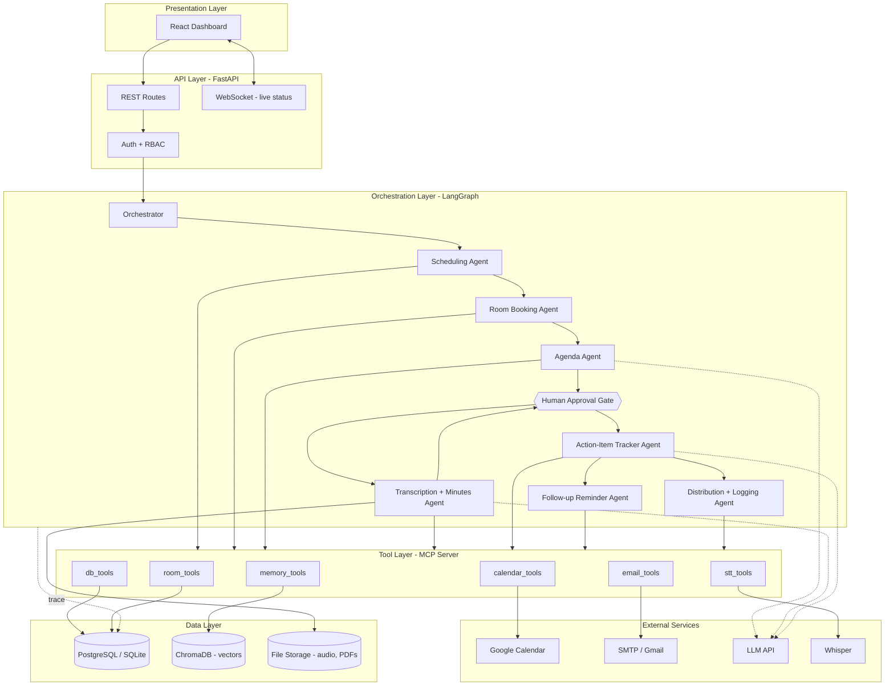
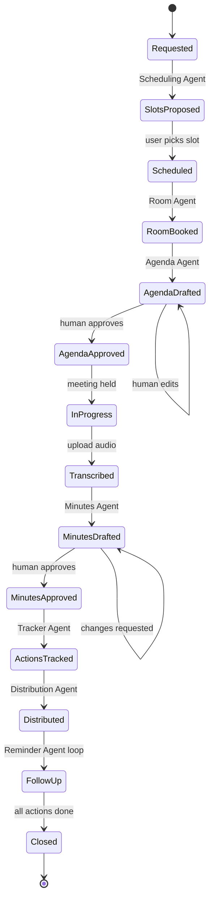
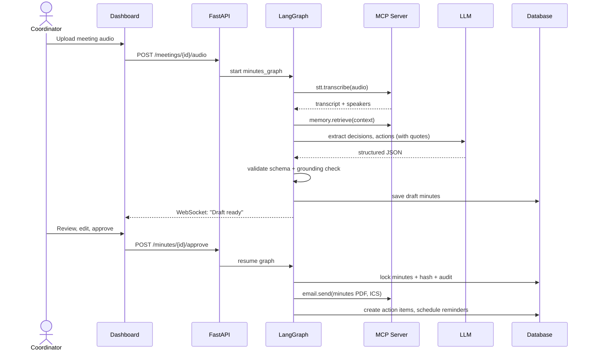
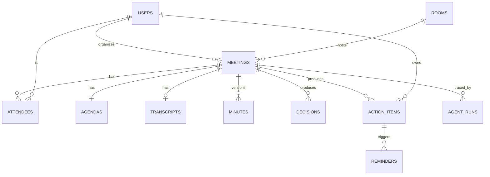
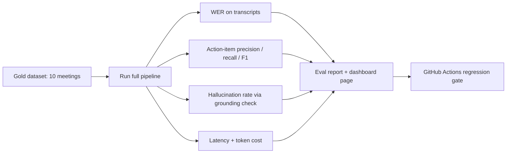
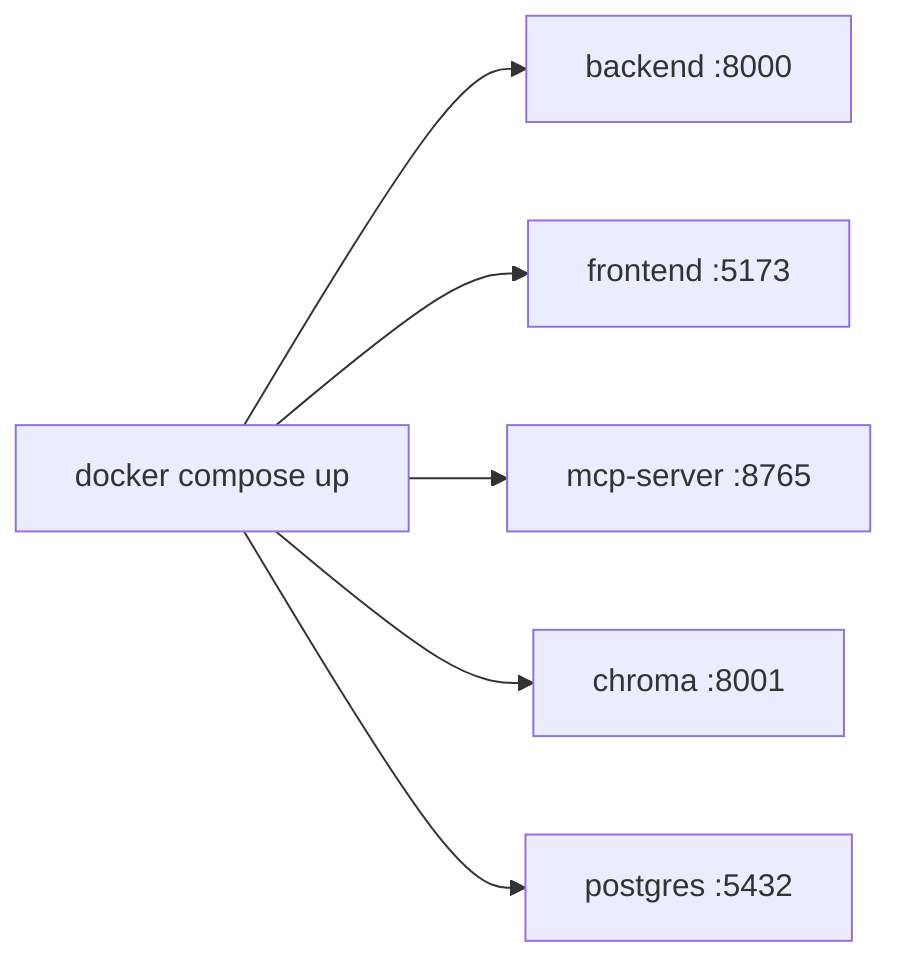

# Meeting Organizer Agent — Architecture

> Multi-agent system that runs the full meeting lifecycle: **schedule → prepare → transcribe → approve → track → follow up.**

---

## 1. Architecture Principles

1. **Agents are nodes, not scripts.** Each agent is a node in an explicit LangGraph graph.
2. **Humans approve anything outbound.** Agenda, minutes, and emails pass a human gate.
3. **Tools via MCP.** All external capabilities (calendar, email, rooms, DB) sit behind one MCP server.
4. **Everything is traced.** Each agent step, prompt, tool call, latency, and token count is logged.
5. **Grounded outputs.** Every action item and decision carries a source quote and timestamp.
6. **Swappable parts.** LLM, STT, vector store, and calendar provider sit behind interfaces.

---

## 2. System Architecture



### Layer responsibilities

| Layer | Responsibility |
| --- | --- |
| **Presentation** | Dashboard, approval editor, trace viewer, memory chat |
| **API** | HTTP/WebSocket, auth, validation, job kickoff |
| **Orchestration** | Agent graph, state, routing, retries, approval pauses |
| **Tool (MCP)** | Uniform, permissioned access to all external actions |
| **Data** | Relational data, vectors, files |
| **Observability** | Traces, audit log, eval metrics |

---

## 3. App Flow

### 3.1 End-to-end lifecycle



### 3.2 Sequence: minutes generation and approval



### 3.3 Reminder escalation loop

`Open item → due in 2 days: gentle reminder → due today: nudge → overdue: reminder + notify chair → done/closed.`

---

## 4. Agent Specifications

| Agent | Graph node | Reads | Writes | MCP tools |
| --- | --- | --- | --- | --- |
| **Orchestrator** | `route` | Request, state | Next node | none |
| **Scheduling** | `schedule` | Attendee calendars | Ranked slots | `calendar.freebusy`, `calendar.create_event` |
| **Room Booking** | `book_room` | Rooms, headcount | Booking | `room.search`, `room.book` |
| **Agenda** | `agenda` | Topic, past minutes, open actions | Agenda | `memory.retrieve`, `db.open_actions` |
| **Transcription + Minutes** | `minutes` | Audio | Transcript, draft minutes, decisions | `stt.transcribe`, `memory.retrieve` |
| **Action Tracker** | `actions` | Approved minutes | Action items | `db.create_action` |
| **Follow-up Reminder** | `reminders` | Open actions | Reminders | `email.send`, `calendar.create_event` |
| **Distribution + Logging** | `distribute` | Approved artifacts | Emails, audit log | `email.send`, `db.audit` |

**Shared graph state (`MeetingState`)**: `meeting_id, attendees, slot, room, agenda, transcript, minutes, decisions, actions, approvals, errors, trace_id`.

**Guardrails per agent:** schema-validated output (Pydantic), retry with backoff, max-step limit, tool permission scope, PII redaction before LLM.

---

## 5. Tech Stack

| Layer | Technology | Why |
| --- | --- | --- |
| Language | Python 3.11 | Course language, best AI ecosystem |
| API | FastAPI + Uvicorn | Async, auto OpenAPI docs, WebSockets |
| Validation | Pydantic v2 | Typed agent I/O |
| Orchestration | LangGraph | Explicit node graph, human-in-loop, checkpointing |
| LLM | Claude API (provider-agnostic wrapper) | Strong structured extraction |
| STT | faster-whisper | Local, accurate, free |
| Embeddings | sentence-transformers (all-MiniLM-L6-v2) | Local, fast |
| Vector DB | ChromaDB | Simple, persistent |
| Relational DB | SQLite (dev) → PostgreSQL | SQLAlchemy + Alembic migrations |
| Tool protocol | MCP Python SDK | Rubric: MCP/tool integration |
| Scheduler | APScheduler | Reminder jobs |
| Calendar | Google Calendar API (OAuth2) | Real availability |
| Email | SMTP / Gmail API | Distribution |
| PDF | WeasyPrint / ReportLab | Minutes export |
| Frontend | React + Vite + TypeScript | Dashboard |
| UI | Tailwind + shadcn/ui | Polished fast |
| Charts | Recharts | Health score, eval charts |
| State/data | TanStack Query | Server state |
| Observability | Custom trace store (+ optional Langfuse) | Trace viewer |
| Testing | pytest, pytest-asyncio, Playwright | Unit, integration, E2E |
| Eval | Custom harness (jiwer for WER, sklearn for F1) | Evidence of quality |
| DevOps | Docker Compose, GitHub Actions | One-command run, CI |
| Deploy | Render / Railway (API), Vercel (UI) | Free tiers |

---

## 6. Folder and File Structure

```
meeting-organizer-agent/
├── README.md
├── docs/
│   ├── PRD.md
│   ├── architecture.md
│   ├── research-report.md
│   └── diagrams/
├── docker-compose.yml
├── .env.example
├── Makefile
├── pyproject.toml
│
├── backend/
│   ├── app/
│   │   ├── main.py                    # FastAPI entrypoint
│   │   ├── config.py                  # settings (env)
│   │   ├── api/
│   │   │   ├── deps.py                # auth, db session
│   │   │   └── routes/
│   │   │       ├── meetings.py
│   │   │       ├── agendas.py
│   │   │       ├── minutes.py
│   │   │       ├── actions.py
│   │   │       ├── rooms.py
│   │   │       ├── memory.py          # memory chat
│   │   │       ├── traces.py
│   │   │       ├── evals.py
│   │   │       └── admin.py
│   │   ├── core/
│   │   │   ├── security.py            # JWT, RBAC
│   │   │   ├── logging.py
│   │   │   └── pii.py                 # redaction
│   │   ├── db/
│   │   │   ├── base.py
│   │   │   ├── models/                # users, meetings, minutes, actions...
│   │   │   ├── schemas/               # Pydantic
│   │   │   └── migrations/            # Alembic
│   │   ├── agents/
│   │   │   ├── state.py               # MeetingState
│   │   │   ├── graph.py               # LangGraph wiring + approval gates
│   │   │   ├── orchestrator.py
│   │   │   ├── scheduling.py
│   │   │   ├── room_booking.py
│   │   │   ├── agenda.py
│   │   │   ├── minutes.py
│   │   │   ├── action_tracker.py
│   │   │   ├── reminder.py
│   │   │   ├── distribution.py
│   │   │   └── prompts/               # versioned prompt templates
│   │   ├── skills/                    # reusable skills (Lab 3)
│   │   │   ├── agenda_writer/SKILL.md
│   │   │   ├── minutes_writer/SKILL.md
│   │   │   └── action_extractor/SKILL.md
│   │   ├── services/
│   │   │   ├── llm.py                 # provider-agnostic wrapper
│   │   │   ├── stt.py
│   │   │   ├── slot_scorer.py         # ranking algorithm
│   │   │   ├── date_resolver.py       # "by Friday" -> date
│   │   │   ├── grounding.py           # quote verification
│   │   │   ├── health_score.py
│   │   │   └── pdf.py
│   │   ├── memory/
│   │   │   ├── vector_store.py
│   │   │   ├── ingest.py              # chunk + embed minutes
│   │   │   ├── retriever.py
│   │   │   └── decision_log.py        # contradiction detection
│   │   ├── observability/
│   │   │   ├── tracer.py              # decorator: logs every step
│   │   │   └── audit.py
│   │   └── jobs/
│   │       └── reminders.py           # APScheduler
│   │
│   ├── mcp_server/
│   │   ├── server.py                  # MCP entrypoint
│   │   └── tools/
│   │       ├── calendar_tools.py
│   │       ├── room_tools.py
│   │       ├── email_tools.py
│   │       ├── stt_tools.py
│   │       ├── db_tools.py
│   │       └── memory_tools.py
│   │
│   ├── evals/
│   │   ├── datasets/
│   │   │   ├── meetings/              # 10 audio + gold transcripts
│   │   │   └── gold_actions.json
│   │   ├── run_eval.py                # WER, F1, hallucination rate
│   │   └── reports/
│   │
│   └── tests/
│       ├── unit/
│       ├── integration/
│       └── e2e/
│
├── frontend/
│   ├── package.json
│   ├── vite.config.ts
│   └── src/
│       ├── main.tsx
│       ├── api/                       # typed client
│       ├── components/
│       │   ├── ui/
│       │   ├── SlotCard.tsx
│       │   ├── AgendaEditor.tsx
│       │   ├── MinutesReview.tsx      # split editor
│       │   ├── ActionKanban.tsx
│       │   ├── TraceTimeline.tsx
│       │   └── HealthGauge.tsx
│       ├── pages/
│       │   ├── Dashboard.tsx
│       │   ├── NewMeeting.tsx
│       │   ├── MeetingDetail.tsx
│       │   ├── MinutesReviewPage.tsx
│       │   ├── ActionTracker.tsx
│       │   ├── MemoryChat.tsx
│       │   ├── TraceViewer.tsx
│       │   ├── Evaluation.tsx
│       │   └── Admin.tsx
│       ├── hooks/
│       └── lib/
│
├── data/
│   ├── seed/                          # demo mode data
│   └── uploads/
│
└── .github/workflows/ci.yml
```

---

## 7. Data Architecture



Vectors live in ChromaDB: one chunk per speaker turn group, with `meeting_id, speaker, start_time` metadata.

---

## 8. API Surface (key endpoints)

| Method | Endpoint | Purpose |
| --- | --- | --- |
| POST | `/meetings` | Start request, trigger scheduling |
| GET | `/meetings/{id}/slots` | Ranked slots with reasons |
| POST | `/meetings/{id}/confirm` | Choose slot, book room |
| GET/PUT | `/meetings/{id}/agenda` | View/edit agenda |
| POST | `/meetings/{id}/audio` | Upload recording |
| GET | `/meetings/{id}/minutes` | Draft/approved minutes |
| POST | `/minutes/{id}/approve` or `/reject` | Approval gate |
| GET/PATCH | `/actions` | Tracker |
| POST | `/memory/ask` | Cited Q&A across meetings |
| GET | `/traces/{run_id}` | Trace timeline |
| POST | `/traces/{run_id}/replay` | Replay run |
| GET | `/evals/latest` | Metrics |
| WS | `/ws/meetings/{id}` | Live agent status |

---

## 9. Cross-Cutting Concerns

| Concern | Design |
| --- | --- |
| **Security** | OAuth2 for Google, JWT sessions, RBAC (admin / coordinator / approver / attendee), secrets in env |
| **Privacy** | PII redaction before LLM calls; audio retention policy |
| **Reliability** | Retries with exponential backoff; LangGraph checkpointing so crashed runs resume |
| **Safety** | Approval gates, tool permission scopes, max-step limits, action rollback |
| **Observability** | `@trace` decorator logs prompt, output, tools, latency, tokens into `agent_runs` |
| **Quality** | Grounding check rejects any action item whose quote is not found in the transcript |
| **Performance** | Cache embeddings and calendar lookups; run availability fetches in parallel |

---

## 10. Quality and Evaluation Architecture



**Targets:** WER \< 15%, action F1 ≥ 0.80, hallucination \< 5%.

---

## 11. Deployment



One command (`make up`) runs the whole stack. `make demo` loads seeded data and runs the full lifecycle for presentation.

---

## 12. Build Order

1. DB models + FastAPI skeleton + auth
2. MCP server with calendar, room, DB tools
3. Scheduling and room agents, then LangGraph skeleton with approval gate
4. Memory ingest/retrieval, then Agenda agent
5. STT + Minutes agent with grounding check
6. Tracker + Reminder + Distribution agents
7. Dashboard pages, trace viewer, memory chat
8. Eval harness, tests, CI, demo mode, polish